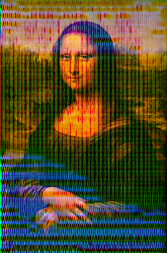

<div align="center">


# Kealzyl Somnium
**What if AI could have dreams?**

</div>

<br>

# Setup :
### **!!!   If you don't want to train, but try the model, you can find the weights [here](https://huggingface.co/Kealzyl/somnium/blob/main/kealzyl_somnium_model/kealzyl_somnium_weights.pth)   !!!** <br><br>

1. Install libraries :
```pip
pip install torch torchvision pillow
```
2. Download and extract the zip

3. Open the folder
  
5. Download and extract the dataset from [here](https://github.com/kealzyl/somnium/releases/download/dataset/dataset.zip).

6. Place the extracted folder in the downloaded project

7. Train by running :
```python
python train_kealzyl_somnium.py --epochs 150 --batch-size 4 --amp
```

## Usage :
1. For simple usage use just :
```python
python kealzyl_somnium_dream.py --input input.jpg 
```
and replace input.jpg with your image

2. For more realistic results use :
```python
python kealzyl_somnium_dream.py --input input.jpg --layer block3 --intensity 1.0  --steps 60 --octaves 4 --max-side 768
```

## Examples:
<br>
Ran:
```python
python kealzyl_somnium_dream.py --input input.jpg --layer block3 --intensity 1.0  --steps 60 --octaves 4 --max-side 768
```
And it outputted : <br>
<br><br>

### # Pretrained models can be found [here](https://huggingface.co/Kealzyl/somnium/tree/main/kealzyl_somnium_model).
